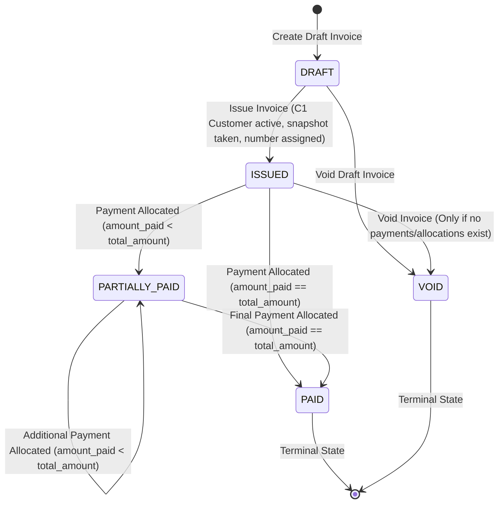

# BizBrain Invoice Service

Production-grade **Invoice Service** microservice for BizBrain, a multi-tenant small-business finance platform.

The Invoice Service is the **single source of truth** for invoice details, invoice numbering, status lifecycles, outstanding balances, payment allocations, and payment reconciliation exceptions.

---

## 1. System Scope & Boundaries

### What the Invoice Service Owns:
- **Invoices & Items**: Draft creation, calculations, modifications, issuance, and voiding.
- **Invoice Numbering**: Gap-free, deterministic sequential numbering per business (`{prefix}{YYYY}-{0001}`).
- **Calculations & Money**: Minor-unit tax and totals arithmetic using `Decimal` and `ROUND_HALF_UP`.
- **Status Lifecycle**: State machine governing transitions across `DRAFT`, `ISSUED`, `PARTIALLY_PAID`, `PAID`, and `VOID`.
- **Payment Allocations**: Processing incoming `PaymentCaptured` events from Payment Service and updating balances atomically.
- **Reconciliation Exceptions**: Recording and resolving failed or mismatched payment allocations.
- **Configuration**: Tenant-specific invoice settings (prefixes, seller snapshots) and tax rates.

### What the Invoice Service Does NOT Do:
- Does **NOT** authenticate users (verifies RS256 tokens issued by User Service).
- Does **NOT** manage customer records (queries Financial Data Service via internal API and stores snapshots upon issue).
- Does **NOT** interact with PayPal or external payment gateways (handled exclusively by Payment Service).
- Does **NOT** create credit notes, refunds, or reversals in Stage 1.
- Does **NOT** query or share any database with other microservices.

---

## 2. Tech Stack

- **Runtime**: Python 3.12+
- **API Framework**: FastAPI with Pydantic v2
- **Database**: PostgreSQL 16+ with SQLAlchemy 2.x (asyncpg)
- **Migrations**: Alembic with dual-role security separation
- **Authentication**: PyJWT with RS256 JWKS caching, automatic `kid` rotation, and service tokens
- **HTTP Client**: HTTPX with exponential retries, timeouts, and circuit breakers
- **Structured Logging**: `structlog` with JSON output and distributed `request_id` correlation
- **Testing**: `pytest`, `pytest-asyncio`, `pytest-cov`, and real PostgreSQL

---

## 3. Project Structure

```
invoice-service/
├── alembic.ini                   # Alembic configuration
├── Dockerfile                    # Container definition
├── requirements.txt              # Production and dev dependencies
├── app/
│   ├── api/                      # API Routers
│   │   ├── invoices.py           # Public invoice CRUD, issue, void, overdue, recon endpoints
│   │   ├── internal.py           # Internal C2, C4, C3 endpoints for Payment Service
│   │   ├── settings.py           # Tenant invoice settings (/api/v1/invoice-settings)
│   │   └── tax_rates.py          # Tenant tax rates (/api/v1/tax-rates)
│   ├── clients/                  # Inter-service HTTP clients
│   │   ├── user_service_client.py       # C5 User Service (metadata, live authz, JWKS)
│   │   └── financial_data_client.py     # C1 Financial Data Service (customer verification)
│   ├── core/                     # Platform infrastructure & cross-cutting concerns
│   │   ├── auth.py               # RS256 JWT & service token validation, tenancy context
│   │   ├── config.py             # Strongly typed pydantic-settings
│   │   ├── database.py           # Async SQLAlchemy engine & session factory
│   │   ├── errors.py             # Custom exceptions & global exception handlers
│   │   ├── idempotency.py        # IdempotencyKey middleware and replay cache
│   │   ├── jwks.py               # User Service JWKS fetcher & public key cache
│   │   ├── logging.py            # Structured JSON structlog configuration
│   │   ├── middleware.py         # RequestId middleware & logging context
│   │   ├── money.py              # Decimal rounding, quantize, and float rejection
│   │   └── permissions.py        # Role-based permissions matrix & dependency guards
│   ├── models/                   # SQLAlchemy ORM models
│   │   ├── base.py               # Declarative base & UTC helpers
│   │   └── invoice.py            # Invoices, items, allocations, settings, exceptions, audit
│   ├── repositories/             # Data access layer (mandatory business_id scoping)
│   │   ├── allocation_repo.py
│   │   ├── audit_repo.py
│   │   ├── event_repo.py
│   │   ├── invoice_repo.py
│   │   ├── reconciliation_repo.py
│   │   ├── settings_repo.py
│   │   └── tax_rate_repo.py
│   ├── schemas/                  # Pydantic request/response models & envelopes
│   │   ├── envelope.py           # Standard SuccessResponse & ErrorResponse
│   │   ├── internal.py           # C2, C3, C4 internal contract schemas
│   │   ├── invoice.py            # Invoice DTOs & validations
│   │   ├── reconciliation.py     # Reconciliation exception DTOs
│   │   ├── settings.py           # Settings DTOs
│   │   └── tax_rate.py           # Tax rate DTOs
│   ├── services/                 # Business domain services
│   │   ├── allocation.py         # C2 payable details, C4 resolve pay token, C3 event handler
│   │   ├── calculation.py        # Line-by-line ROUND_HALF_UP subtotal & tax calculation
│   │   ├── invoice_service.py    # Draft CRUD, issue, void, balance, payment link
│   │   ├── numbering.py          # Atomic gap-free sequential numbering service
│   │   └── state_machine.py      # Authoritative invoice state transitions
│   └── main.py                   # FastAPI application factory & lifecycle
├── migrations/                   # Alembic migration scripts
│   ├── env.py
│   └── versions/
│       └── 0001_initial_invoice_schema.py
├── tests/
│   ├── api/                      # End-to-end HTTP API integration tests
│   ├── integration/              # Database constraints, migrations, concurrency
│   └── unit/                     # State machine, calculation, numbering, auth
└── contracts/
    ├── api/
    │   └── invoice-service.openapi.yaml   # OpenAPI 3.1 specification
    └── events/
        └── PaymentCaptured.v1.json        # Contract C3 Event JSON Schema
```

---

## 4. Invoice State Machine

All invoice transitions are governed strictly by `app.services.state_machine.transition_invoice_status`:



### State Machine Transition Rules:
1. **DRAFT**: Can transition to `ISSUED` (via `ISSUE` trigger) or `VOID` (via `VOID` trigger).
2. **ISSUED**: Can transition to `PARTIALLY_PAID` or `PAID` via `PAYMENT_ALLOCATION`. Can transition to `VOID` **only** if zero payments have been made (`amount_paid == 0` and no allocations).
3. **PARTIALLY_PAID**: Can receive further payments and remains `PARTIALLY_PAID` until `amount_paid == total_amount`, transitioning to `PAID`. Cannot be voided in MVP.
4. **PAID & VOID**: Terminal states. All further mutations or allocations are rejected.

---

## 5. Security & Multi-Tenancy

- **Mandatory `business_id` Scoping**: Every database query across all repositories requires `business_id: UUID` as an explicit parameter without defaults.
- **Tenant Context Verification**: The `X-Business-ID` header is verified against the caller's JWT `memberships` claim. Cross-tenant access attempts immediately yield `403 Forbidden`.
- **Role Separation in Database**:
  - `invoice_owner`: Used strictly by Alembic for schema migrations and DDL.
  - `invoice_app`: Used at runtime with least-privilege DML (`SELECT`, `INSERT`, `UPDATE`, `DELETE`). Triggers block updates/deletes to append-only tables (`audit_log`, `payment_allocations`).
- **Internal Endpoints**: `/internal/v1/**` endpoints are strictly protected by `require_internal_caller` and require service tokens signed with the internal key and allow-listed `client_id` (e.g., `payment-service`).
- **Live Authorization**: Sensitive financial actions (`invoices.issue`, `invoices.void`) invoke the User Service live authz check (`POST /internal/v1/authz/check`) with fallback to JWT claims.

---

## 6. Permissions Matrix

| Permission Code | OWNER | ADMIN | EMPLOYEE | Description |
|---|:---:|:---:|:---:|---|
| `dashboard.view` | Yes | Yes | Yes | View dashboard and metrics |
| `invoices.create` | Yes | Yes | Yes | Create draft invoices |
| `invoices.edit_draft` | Yes | Yes | Own Drafts Only | Edit draft invoices |
| `invoices.view` | Yes | Yes | Yes | View invoice details and lists |
| `invoices.issue` | Yes | Yes | No | Issue invoices |
| `invoices.void` | Yes | Yes | No | Void invoices |
| `settings.manage` | Yes | Yes | No | Update invoice settings & tax rates |
| `reconciliation.manage` | Yes | Yes | No | View & resolve reconciliation exceptions |

---

## 7. Inter-Service Contracts

| Contract ID | Direction | Endpoint / Topic | Description |
|---|---|---|---|
| **C1** | Invoice Service -> Financial Data Service | `GET /internal/v1/customers/{id}?business_id={biz_id}` | Verifies customer is active and takes immutable snapshot upon issue. |
| **C2** | Payment Service -> Invoice Service | `GET /internal/v1/invoices/{id}/payable-details?business_id={biz_id}` | Returns invoice status, balance, currency, and payable status before checkout & capture. |
| **C3** | Payment Service -> Invoice Service | `POST /internal/v1/payment-events` | Delivers `PaymentCaptured.v1` event for atomic balance allocation and inbox deduplication. |
| **C4** | Payment Service -> Invoice Service | `POST /internal/v1/invoices/resolve-pay-token` | Resolves public SHA-256 token to `invoice_id` and `business_id` for payment checkout. |
| **C5** | All Services -> User Service | `GET /internal/v1/businesses/{id}`<br>`POST /internal/v1/authz/check`<br>`GET /.well-known/jwks.json` | Retrieves business metadata (currency, timezone), performs live authorization, and fetches JWKS. |

---

## 8. Error Codes & Envelope

All API responses follow the standard BizBrain envelope:

### Success Envelope
```json
{
  "success": true,
  "data": { ... },
  "request_id": "req-9b876a5c-..."
}
```

### Error Envelope
```json
{
  "success": false,
  "error": {
    "code": "INVOICE_NOT_PAYABLE",
    "message": "Invoice cannot receive payments in current status: VOID",
    "details": []
  },
  "request_id": "req-9b876a5c-..."
}
```

### Key Error Codes:
- `VALIDATION_ERROR` (422): Input validation failure or constraint violation.
- `UNAUTHORIZED` (401): Missing, expired, or invalid JWT / service token.
- `FORBIDDEN` (403): Missing required permission or tenant mismatch.
- `NOT_FOUND` (404): Resource not found within tenant context.
- `INVALID_STATE_TRANSITION` (409): Illegal invoice state transition attempted.
- `INVOICE_HAS_PAYMENTS` (409): Cannot void invoice with existing payments or allocations.
- `IDEMPOTENCY_CONFLICT` (409 / 422): Idempotency key reused with mismatched payload.
- `EXTERNAL_SERVICE_UNAVAILABLE` (503): Timeout or outage on downstream dependency.

---

## 9. Local Setup & Testing

### 1. Environment Setup
```bash
# Create virtual environment
python -m venv .venv
source .venv/bin/activate  # Or on Windows: .venv\Scripts\Activate.ps1

# Install dependencies
pip install -r invoice-service/requirements.txt
```

### 2. Configuration
Copy the sample environment file:
```bash
cp .env.example .env
```
Ensure PostgreSQL is running and update `DATABASE_URL` and `OWNER_DATABASE_URL` in `.env`.

### 3. Running Database Migrations
```bash
cd invoice-service
alembic upgrade head
```

### 4. Running the Test Suite
```bash
# Run all tests (unit, integration, API)
pytest invoice-service/tests -v

# Run with coverage report
pytest invoice-service/tests --cov=app --cov-report=term-missing
```

### 5. Running the Microservice
```bash
uvicorn app.main:app --host 0.0.0.0 --port 8002 --reload
```
API Documentation will be available at `http://localhost:8002/docs`.
OpenAPI 3.1 YAML is located at `contracts/api/invoice-service.openapi.yaml`.
Event schema is located at `contracts/events/PaymentCaptured.v1.json`.
